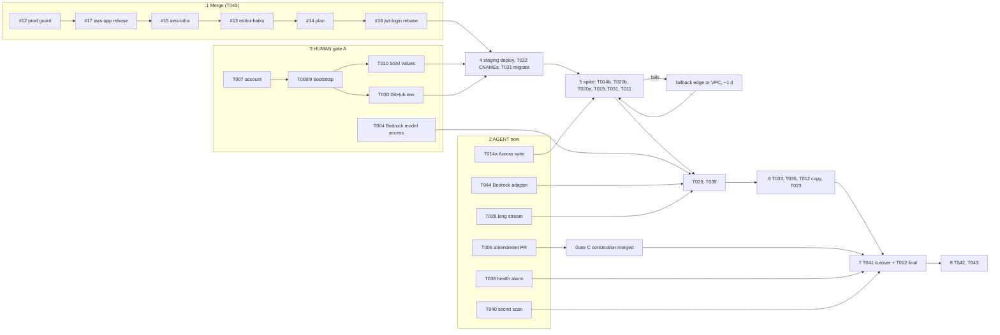

# Implementation Plan: Run Story Engine on AWS (Option S Serverless)

**Branch**: `aws-deployment-plan` | **Date**: 2026-10-16 (v3.1, Option S only, Bedrock in prod, go-live deferred) | **Spec**: [spec.md](./spec.md)
**Input**: spec.md, [research.md](./research.md), draft PRs #17 (`aws-app`) and #15 (`aws-infra`), vault notes
`Projects/Story-Engine/AWS-Deployment-Architecture.md` and `Projects/Doctor-Assistant/Cloud-Architecture.md`
(Doctor-Assist spec 008, the design this follows).

## Summary

**Option S Serverless (D1, human, 2026-10-16)**, modelled on Doctor-Assist: the existing FastAPI app
runs as two Lambda functions behind the Lambda Web Adapter, split by route at an API Gateway REST
API on `api.storyteller.techvigilant.com` (replaces nginx; ADR `split-api-graph`, research.md R7):
`story-api` (every route except generation, buffered) and `story-graph` (`POST /api/v1/stories/generate`
only, response streaming, LangGraph + semantic cache), plus the `migrate` function. CloudFront serves
only the SPA from S3 on `storyteller.techvigilant.com`; both names sit in a Route 53 hosted zone
NS-delegated from Cloudflare; Aurora Serverless v2 PostgreSQL + pgvector (minimum 0 ACU,
auto-pause) is reached through the RDS Data API, so no Lambda needs a VPC or NAT; Redis is removed.
About **$12.60/month** at 1,000 stories, **~$2.40 idle**. Planned effort was 12 person-days; most of it
is built in draft. **Remaining: ~9.25 person-days** (AGENT 4.5 incl. the Bedrock adapter, HUMAN 3.0, FIRST-DEPLOY 1.75), see
"Implementation sequence".

**Status: AWS go-live deferred, not scheduled (human, 2026-10-16). Current mode: local deployment
(docker compose).** The sequence below stays as the plan, without dates.

**Production LLM = Amazon Bedrock (D4 revised).** `story-graph` calls Bedrock with its IAM role
(`UseBedrock=true`, `LlmProvider=bedrock`), so production needs no LLM API key; local dev keeps the
Anthropic API. The Bedrock adapter (T044, ~1.5-2 d AGENT, not started) and Bedrock model access (T004,
HUMAN) are required before production can generate stories. The provider stays switchable by
configuration (`LLM_PROVIDER` / `LlmProvider`, models `Model*`).

## Technical Context

**Language/Version**: Python 3.12 (backend), TypeScript 5 / React 18 / Vite (frontend)
**Primary Dependencies**: FastAPI, LangGraph 1.x, SQLAlchemy async, Alembic, Langfuse (local only),
fastembed ONNX MiniLM, AWS Lambda Web Adapter, boto3 `rds-data`, `ssm`, `codedeploy`
**Storage**: Aurora Serverless v2 PostgreSQL 16.11 + pgvector via the Data API; S3 for the SPA
**Testing**: pytest with mocked LLM and stubbed AWS (botocore Stubber) in CI; integration suite
against a real Aurora outside CI (T014); Playwright e2e on the deployed URL; cfn-lint + `sam validate`
**Target Platform**: AWS us-east-1; three Lambda arm64 container images from one Dockerfile
(targets `api`, `graph`, `migrate`)
**Project Type**: web service + SPA (existing)
**Performance Goals**: SSE streams up to 600 s; first event p95 <= 5 s warm DB; deploy <= 15 min; rollback <= 10 min
**Constraints**: <= $20/month at low traffic, <= $5 idle; no NAT gateway, no ALB, no always-on compute; no secrets in git, images or Lambda env
**Scale/Scope**: under 1,000 stories/month, a few concurrent streams

### Functions (ADR `split-api-graph`, as built in #15 c2e48a82 / #17 f3ac2182)

| Function | Routes (API Gateway REST) | Integration | Memory | Timeout | Concurrency | Image target | SSM read | Holds |
|---|---|---|---|---|---|---|---|---|
| `story-api` | `/`, `/api`, `/api/v1`, `/api/v1/stories`, `/{proxy+}`: auth, stories CRUD/list/export, personalities, payments + SSLCommerz IPN, LLM config, `/health` | BUFFERED (29 s) | 512 MB | 30 s | account pool | `api`, `RUN_ROLE=api` | `shared/` | FastAPI only; no LangGraph, LLM SDKs or ONNX model (build fails if imported) |
| `story-graph` | `POST` + `OPTIONS /api/v1/stories/generate` (SSE) | STREAM | 2048 MB | 900 s (app deadline 600 s) | reserved 20 | `graph`, `RUN_ROLE=graph`, `app.graph_main` | `shared/` (+ `graph/`, optional, unused with Bedrock) | generate route + `/health`; LangGraph + semantic cache (ONNX); JWT, ownership and quota from the shared code; Bedrock grant (`UseBedrock=true` in prod) |
| `migrate` | none (CodeDeploy PreTraffic hook of both functions / manual invoke) | - | as built | as built | 1 | `migrate`, `app.migrate.handler` | none | Alembic; reports hook status |

No Lambda calls another Lambda. Local dev is unchanged: `RUN_ROLE=all` serves everything in one process.

## Constitution Check

| Principle | Status | Note |
|---|---|---|
| I Token cost | PASS | Hosting only; per-story LLM cost unchanged (~$0.0073, lower after #13) if Bedrock prices equal Anthropic list prices (unverified). |
| II Model tiering | PASS | No model change; models are stack parameters. |
| III Provider-agnostic | PASS | Provider by config; production Bedrock is a new adapter (T044), not node edits. |
| IV Observable | **AMEND (T005), blocks cutover** | D5 runs production with tracing off; IV says every generation MUST produce a trace. Local and staging keep traces; `flush()` in `finally`. Amendment must merge before T041. |
| V Streaming contract | PASS | Same events; adds `: ping` comments (ignored by SSE clients) and the `deadline` error code for a 600 s run. |
| VI Secure by default | PASS once #12 and #16 merge | `prod_guard`, no dev fallback in production, API Gateway the only way in, IAM-only DB access, SSM SecureString per function, OIDC deploy bound to an environment. |
| VII Test discipline | PASS with work | CI mocked and stubbed; real-Aurora suite outside CI (T014). |
| VIII Licensing | PASS | Lambda Web Adapter Apache-2.0, fastembed Apache-2.0, AWS SAM CLI Apache-2.0 (tooling). |
| Workflow: CD = `make deploy` + `/health` smoke | **AMEND (T005)** | CD is a manual GitHub Actions deploy job with `/health` smoke. |

## Project Structure

### Documentation (this feature)

```text
specs/002-aws-deployment/
  spec.md       # what and why, Option S
  plan.md       # this file: design, implementation sequence, risks
  research.md   # prices with sources, options considered, decisions D1-D9, ADR R7, analysis R8
  tasks.md      # tasks with status (done in draft / partial / open) and owner
```

### Source code (built in draft; `master` untouched)

```text
backend/Dockerfile.lambda            # #17: targets api (buffered), graph (response_stream, ONNX), migrate
backend/requirements-lambda-api.txt  # #17: api deps; requirements-lambda.txt adds the generation stack
backend/app/main.py                  # #17: RUN_ROLE all/api/graph; generate mounted unless api
backend/app/graph_main.py            # #17: story-graph entry point, generate route + /health only
backend/app/api/v1/generate.py       # #17: SSE generation (ping 15 s, deadline 600 s, flush)
backend/app/api/v1/stories.py        # #17: CRUD only
backend/app/core/web.py              # #17: shared lifespan (prod guard after SSM), CORS, client IP, /health
backend/app/core/dataapi.py          # #17: async Data API dialect, casts, resume retry
backend/app/core/database.py         # #17: DB_BACKEND asyncpg|dataapi
backend/app/core/ssm.py              # #17: SSM SecureString loader (comma-separated paths)
backend/app/core/client_ip.py        # #17: client IP from API Gateway context / X-Forwarded-For
backend/app/core/limits.py           # #17: Postgres rate-limit window; stale running rows ignored
backend/app/migrate.py               # #17: migrate Lambda, CodeDeploy hook status
backend/alembic/versions/0005_*      # #17: rate_limit_window table
backend/app/core/prod_guard.py       # #12: fail closed on dev or missing secrets
frontend/src/lib/auth.ts, pages/LoginPage.tsx  # #16: SPA login, bearer token
infra/bootstrap.yaml                 # #15: OIDC, deploy + CFN roles, ECR, artifact bucket, Route 53 zone, budget
infra/template.yaml                  # #15: Aurora, 3 Lambdas, API Gateway REST split, ACM, CloudFront + S3, DNS, alarms
infra/scripts/dataapi_restore.py     # #15: CSV -> Aurora over the Data API (T012)
.github/workflows/deploy.yml         # #15: manual deploy / rollback
docs/runbook-aws.md                  # #15: human steps 0-10
```

**Structure Decision**: infrastructure lives under top-level `infra/`, as in Doctor-Assist; the app
keeps its shape with two extra entry points (`app.graph_main`, `app.migrate`).

## Phases (effort as planned, and remaining)

| Phase | Option S | Planned d | Remaining d | Remaining owner |
|---|---|---|---|---|
| P0 | Prod readiness: #12, #16, Bedrock model access, constitution amendment, story duration | 1.5 | 1.0 | merges + model access HUMAN; T005/T006 AGENT |
| P1 | SAM base: ECR, OIDC role, SSM parameters, budget | 1.0 | 0.6 | HUMAN (account, bootstrap, SSM, GitHub env) |
| P2 | Aurora SV2 + pgvector + Data API, data move | 1.0 | 0.75 | HUMAN (T012), FIRST-DEPLOY (T011) |
| P3 | Data access over Data API (dialect, txns, casts, retry, tests) | 3.0 | 1.0 | AGENT T014a, FIRST-DEPLOY T014b |
| P4 | Lambda images, api/graph split, ping, deadline, flush, no Redis, ONNX | 2.0 | 0.5 | FIRST-DEPLOY (arm64, stream spike) |
| P5 | Edge: Route 53, ACM, API Gateway REST, S3 + CloudFront, CORS | 1.0 | 0.75 | HUMAN (CNAMEs, staging NS), FIRST-DEPLOY (routes) |
| P6 | CI/CD: OIDC, migrate hook, alias deploy + rollback | 1.0 | 0.75 | HUMAN (env), FIRST-DEPLOY (hook, rollback) |
| P7 | Alarms, long-stream + cold-start + IPN tests, secret scan, cutover | 1.5 | 1.65 | AGENT (T028, T036, T040, T042), HUMAN (T035, T041) |
| P8 | Integration (T045) | - | 0.5 | AGENT rebases, HUMAN merges |
| P9 | Bedrock adapter (T044, D4 revised) | - | 1.75 | AGENT |
| **Total** | | **12** | **~9.25** | +1.0 contingency for spike fallout |

## Implementation sequence

Deferred, not scheduled: the steps are ordered, not dated. As of 2026-10-16 everything is in draft
PRs and nothing runs on AWS; PRs #12, #14, #15, #17 are drafts and wait.

### Critical path

1. **Merge P0 code** (HUMAN review, AGENT rebases, T045): #12 `prod-config-safety` -> #17 `aws-app`
   (retarget its base from `prod-config-safety` to `master`, rebase) -> #15 `aws-infra` (its runbook
   needs the app merged) -> #13 `editor-haiku` (rebase: `config.py` `MODEL_SYNTHESIZER`,
   `test_agents.py`) -> #14 this plan -> #16 `jwt-login` (rebase after #17: `config.py`,
   `SettingsPage.tsx`). CI green after each merge.
2. **AGENT, in parallel with 1** (no AWS needed): T044 Bedrock adapter (mocked client), T014a
   real-Aurora integration suite (Data API shim first: it is the largest risk), T028 long-stream e2e,
   T036 `/health` alarm, T040 secret scan of repo and images, T005 constitution amendment PR.
3. **HUMAN gate A, account** (runbook 1-4): T007 account + MFA; T008/T009 bootstrap stack;
   T010 SSM SecureStrings (`shared/JWT_SECRET_KEY`, SSLCommerz; no LLM key with Bedrock);
   T030 GitHub environment `production` with reviewers + 5 repo variables; T004 Bedrock model access
   (use-case form; generation fails until then).
4. **Staging deploy** (runbook 5): dispatch `deploy` with smoke off; T022 ACM CNAMEs in Cloudflare
   (grey cloud, no Tunnel change); T031 manual migrate invoke for the first create.
5. **Spike, FIRST-DEPLOY** (on pinned names, Data API shim first): T014b integration suite against
   Aurora -> T020b LWA `response_stream` behind REST STREAM, events one by one -> T020a parent
   routes -> T019a/b arm64 images start -> T031 both PreTraffic hooks succeed -> T011 pgvector ->
   T029 Playwright -> T039 cold start, pause resume, throttle status, IPN sandbox.
   **Gate B**: spike fails -> fallback edge (function URL behind CloudFront, ~1 d AGENT) or D7
   fallback (VPC + asyncpg + NAT instance, ~1 d AGENT, ~$7/month), then repeat step 5.
6. **Rehearsals**: T033 rollback per function; T035 point-in-time restore; T012 data move into a
   scratch copy; T023 NS delegation of a staging sub-zone. T005 merged (**Gate C**: constitution).
7. **Cutover T041** (HUMAN, maintenance window ~1 h): stop writes at home -> CSV export -> T012
   final load with row-count check -> Cloudflare: delete Tunnel + ACM CNAMEs, add 4 NS records ->
   `/health`, login, one story, IPN sandbox -> keep home server read-only 7 days.
8. **After**: T042 vault notes; T043 first bill vs SC-002; turn on automatic deploys only with the
   human's approval.

### Rollback

| When | How | Time |
|---|---|---|
| Bad release (code) | Deploy workflow `rollback`: `live` alias of `story-api`, `story-graph` or both to an earlier version (last ~3 deploys reachable: ECR keeps 10, a deploy pushes 3) | minutes (SC-004 <= 10) |
| Bad migration | Migrations are expand-then-contract, so the old code runs on the new schema; if one must be undone, `alembic downgrade` from the migrate image before moving the alias | < 30 min |
| Bad SPA | Re-run deploy on the previous good commit | ~10 min |
| Data loss / corruption | Aurora point-in-time restore (7 days) to a new cluster, point the stack at it | <= 1 h (SC-005) |
| Cutover fails (before writes on AWS) | Cloudflare: remove the NS records, restore the Tunnel record; home server still has all data | DNS TTL (minutes) |
| Cutover fails (after writes on AWS) | As above, plus export the new rows from Aurora (Data API) and load them at home; keep the window short and announce it | ~1 h |

### Remaining effort (person-days)

| Owner | Tasks | Days |
|---|---|---|
| AGENT | T044 1.75, T005 0.25, T006 0.25, T014a 0.5, T028 0.5, T036 0.25, T040 0.25, T042 0.25, T045 0.5 | **4.5** (+1.0 spike-fallout contingency) |
| HUMAN | reviews/merges 0.5, T004 0.1, T007 0.25, T008/T009 0.25, T010 0.1, T030 0.15, T022 + first deploy 0.25, T012 rehearsal + move 0.5, T023 0.25, T035 0.25, T041 0.25, approvals 0.15 | **3.0** |
| FIRST-DEPLOY | spike T020a/b, T019 arm64, T031, T011 0.5; T014b 0.5; T029 0.25; T033 0.25; T039 0.25 | **1.75** (human runs, agent assists) |
| **Total** | | **~9.25**, ~10.25 with contingency |

### Dependency graph



### Risks

| # | Risk | Likelihood / impact | Mitigation |
|---|---|---|---|
| 1 | Data API dialect fails on real Aurora (casts, enum, vector, transactions; Doctor-Assist bug 2) | medium / high: every route | **Shim first**: T014a written now, T014b is the first step of the spike; D7 fallback = Lambda in VPC + asyncpg `NullPool` + NAT instance (~1 d, ~$7/month) |
| 2 | LWA `response_stream` output not accepted by API Gateway REST STREAM (no source shows the combination) | medium / high: no SSE | Spike before anything else on generation; fallback = function URL behind CloudFront with `X-Origin-Verify` (research.md R1, ~1 d) |
| 3 | Bedrock adapter not built; model access needs the Anthropic use-case form; inference-profile IDs need the account (Doctor-Assist bugs 6) | certain until T044 + T004 / high: no generation in prod | T044 with a mocked client before any deploy; T004 early (approval can take time); provider is config-only, so `anthropic` with a funded key stays a fallback |
| 4 | Two PreTraffic hooks share one migrate function with concurrency 1 | low / medium: deploy fails | Relies on CodeDeploy invoking hooks asynchronously (retried when throttled); check on the first deploy; fallback = one migrate function per hook |
| 5 | Parent routes `/api/v1/stories` next to the generate resource misroute | low / medium | Explicit parent mappings in the template; T020a check; infra tests cover the mapping |
| 6 | arm64 image build or wheels (onnxruntime, asyncpg) fail in CI | low / medium | Verified on amd64 only; first deploy builds arm64; fallback `Architectures: x86_64` (~20% more compute, still in the free tier) |
| 7 | Constitution IV conflicts with D5 (tracing off in production) | certain / blocks cutover | T005 amendment before T041 (Gate C) |
| 8 | Aurora resume (~15 s, longer after 24 h) vs 29 s buffered limit on story-api | medium / low | `DATAAPI_RESUME_TIMEOUT_SECONDS=20` on story-api; measure in T039; add an SPA retry on 503 only if T039 shows failures |
| 9 | Rollback depth only ~3 deploys | low / low | Raise ECR keep count if needed (cents per month) |
| 10 | Data diverges during cutover | low / medium | Maintenance window, writes stopped at home, row-count check, home read-only 7 days |

## Complexity Tracking

| Violation / addition | Why needed | Simpler alternative rejected because |
|---|---|---|
| Data API dialect under SQLAlchemy async | Keeps Lambda out of the VPC: no NAT ($33/month), no open DB port; Doctor-Assist pattern | Lambda in VPC + NAT instance is D7's alternative and the fallback (risk 1) |
| SSE heartbeat + run deadline | Keeps API Gateway (5 min idle) from dropping an idle stream; a Lambda timeout skips `finally` | None: without them streams drop and stories stick in `running` |
| Redis removed | No always-on cache in a serverless stack | ElastiCache costs more than the whole Option S bill |
| Two app functions (`story-api`, `story-graph`) | Separate memory, timeout, concurrency cap, image and SSM scope (ADR `split-api-graph`) | One function: 2048 MB/900 s for every CRUD call and shared concurrency. Lambda->Lambda: double compute. SQS/Step Functions: breaks token streaming |
| CD moves from `make deploy` to a deploy job | No home server shell any more | SSH-from-laptop deploys break FR-005 |
